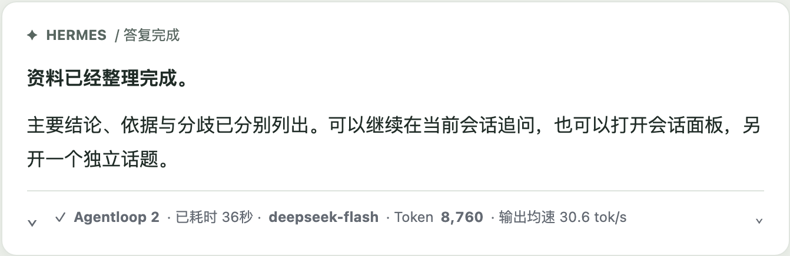
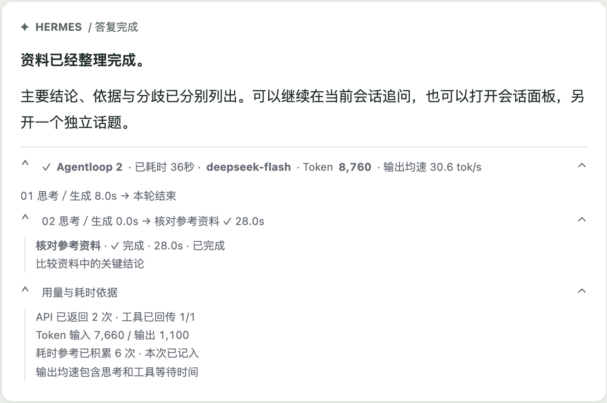
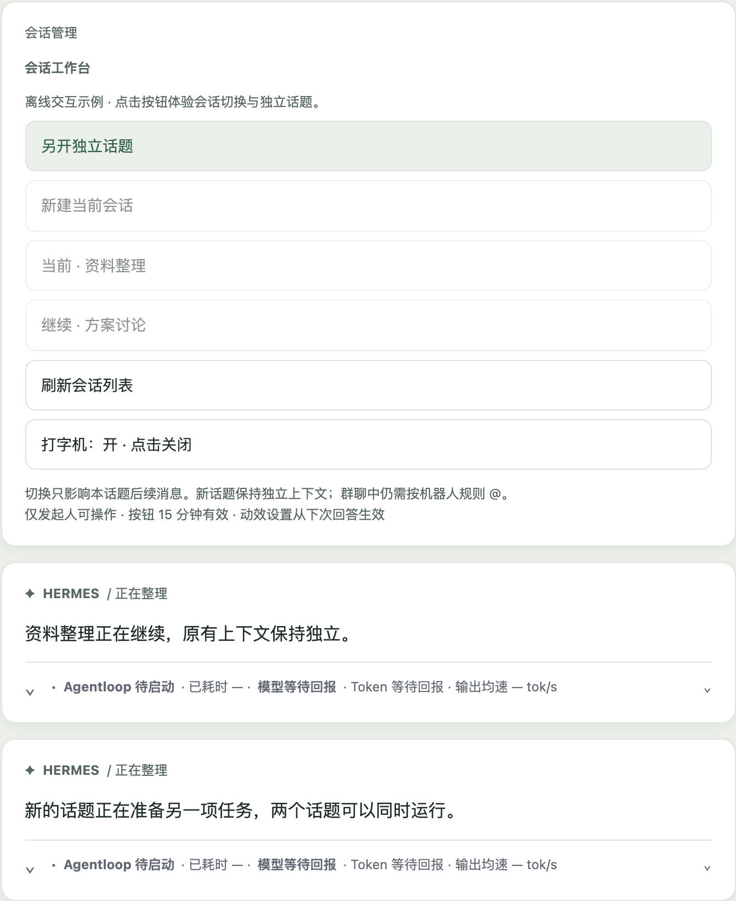

<div align="center">

# Hermes Feishu Streaming

### Follow the progress. Keep the answer clear.

[简体中文](README.md) · **English**

[Preview](#preview) · [Quick start](#quick-start) · [Installation](docs/installation.md) · [User guide](docs/session-experience.md)

[](https://github.com/Moonawn/moonawn-hermes-feishu-streaming/actions/workflows/ci.yml) [](LICENSE)

</div>

**Stream Hermes answers in Feishu, follow task progress, and work across separate conversations.**

Keep the answer readable and expand execution details when needed. Model, tokens, elapsed time and average output rate share a compact footer. Resume a previous session or open another thread for a separate task.

**Current version: `0.3.0rc8` prerelease. Compatibility target: Hermes 0.22.1.**


## Start with a message

| What you do in Feishu | What the plugin provides |
| :--- | :--- |
| Send a task | A progressively updated answer with the final response kept in the same card |
| Check progress | A metrics footer and expandable Agentloop/tool details |
| Return to an earlier conversation | A `/sessions` panel backed by native Hermes context |
| Start another task | An independent parallel thread, or explicit `/queue` for sequential tasks |

## Preview

The answer and metrics have distinct places. Execution details stay collapsed until needed.



<details>
<summary><strong>Expand Agentloop for tool calls and usage details</strong></summary>



Calls are grouped by round. Important failures are retained, repeated successful summaries are combined, and the visible history has a bounded number of nodes.

</details>

<details>
<summary><strong>Switch sessions and open parallel threads</strong></summary>



Sessions use native Hermes context and permissions. A running session cannot be switched in place from the panel; a separate thread can handle another task.

</details>

UI images use synthetic data rendered by the local demo. Feishu controls the actual client fonts, themes and component appearance.

## Quick start

Requires **Python 3.11+, Unix and Hermes 0.22.1**. The Python plugin reuses the host's native Feishu SDK, authentication and permissions.

```sh
git clone https://github.com/Moonawn/moonawn-hermes-feishu-streaming.git
cd moonawn-hermes-feishu-streaming
python3 scripts/verify.py
python3 scripts/build_release.py
```

This verifies the source and builds `dist/moonawn-feishu-0.3.0rc8.zip` with a SHA-256 manifest. It does not install the plugin or connect a bot.

Use an isolated test instance first; follow [installation and rollback](docs/installation.md). One profile per process, with an in-process Python plugin. Do not let multiple streaming plugins own Feishu reply delivery at once. Detailed guides are currently in Chinese.

## Keep the process beside the answer

The footer shows **Agentloop · elapsed time · model · tokens · average output rate**. Expanded details include API calls, input/output usage, cache usage and tool status. Metrics come from native callbacks and reported usage, not character-count estimates.

Remaining-time estimates learn from successful runs. At least five comparable samples matching current progress are required; cold starts show accumulation progress. Average output rate includes model and tool waiting time, so it is not pure decoding throughput.

[Interaction and metric definitions →](docs/session-experience.md)

<details>
<summary><strong>Development checks and local preview</strong></summary>

165 offline tests and Python 3.11–3.13 CI have passed. Separate pinned-host checks cover plugin loading/unloading and SDK integration.

```sh
python3 scripts/verify.py
python3 scripts/build_preview.py
# Open artifacts/preview.html in a browser
```

HTML is only an offline interaction demo. Playwright checks its layout; neither is part of the Python runtime. Optional host and browser checks are described in the [installation guide](docs/installation.md).

</details>

## Current scope

Isolated live acceptance covered session switching, two parallel threads, stop isolation, explicit queues, metrics, attachment downloads and Chrome Web interaction. Mobile clients, sustained load, multiple profiles per process and complete live approval flows remain unverified.

[Verification and limits](docs/acceptance.md) · [Architecture](docs/architecture.md)

---

Inspired by the card design in the [official OpenClaw Feishu plugin](https://github.com/larksuite/openclaw-lark) and maintenance experience from the earlier [HLS fork](https://github.com/Moonawn/hermes-lark-streaming) ([upstream](https://github.com/Aowen-Nowor/hermes-lark-streaming)). [Credits](ACKNOWLEDGEMENTS.md) · [Third-party notices](docs/THIRD_PARTY_NOTICES.md)

[User guide](docs/session-experience.md) · [Issues](https://github.com/Moonawn/moonawn-hermes-feishu-streaming/issues) · [MIT License](LICENSE) · [简体中文](README.md)

Copyright (c) 2026 Moonawn.
