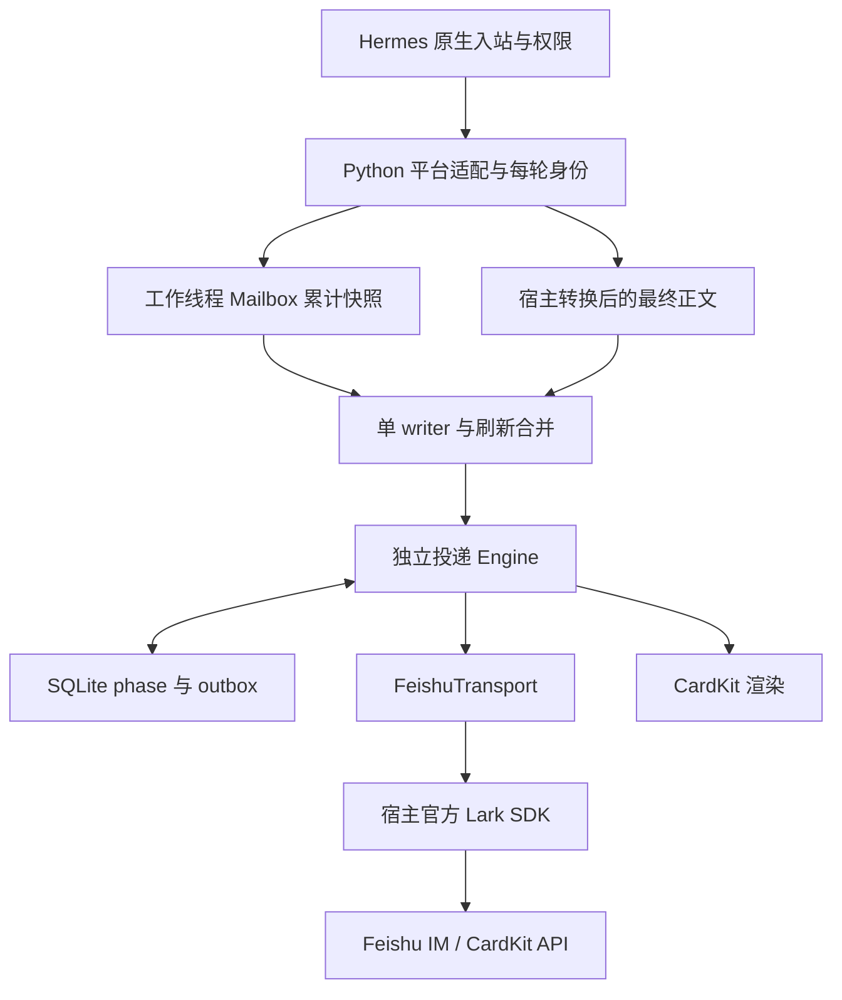

# Python 流式实现架构

更新：2026-10-28，公开候选 0.3.0rc9。

## 责任边界

本插件不是另一个网关。原生 adapter 负责入站、权限、连接、附件、引用消息与审批；我们的子类保留这些能力。运行时不依赖参考项目代码，Python 标准库承担状态、同步、渲染与 outbox，SDK 客户端和身份由宿主注入。

Hermes 当前没有一个经过验证的公开接口同时给出全部必要的最终投递语义，投递层有四个集中兼容点：consumer 类路由、每轮 `_run_agent_inner`、转换后的 `_run_agent_mark_streamed_delivery`、排队 `_deliver_queued_first_response`。只对本插件 adapter 及上下文生效，其他平台走原实现。加载前检查签名，注册失败回滚，卸载恢复方法。会话与统计层另外包装原生 callback wiring 和 sessions/reset/resume 三个命令入口，另有历史会话 owner 检查及 native retry/delivery ledger 的所有权适配；并为无参数 `/sessions` 增加经原生 ACL/profile scope 的忙时面板入口；当前共 19 项静态签名检查。不能将这层维护成本说成零。

## 身份和终态

Route 保存应用 namespace、bot、profile、chat、thread、anchor。当前 tenant 字段使用 app_id 作本插件命名空间，并不是声明已取得真实 tenant_key。turn 从 session_key 与原始 inbound_message_id 得出，不能用 anchor、相同正文或时间相近猜测同一轮。

begin → snapshot/tool → final/error/cancel。final 冻结正文，phase 明确表示同一轮补充；下一个 inbound 是新 turn。工具边界和正文变短不创建补充。排队递归入口重新绑定身份，最终完成发送跟随实际返回任务。原生 FIFO/redirect 决策不由本插件修改。

消费工作线程的 Mailbox 累计正文，预览容量 500,000 字符；溢出只停预览，完整终稿从宿主完成路径进入。最终信号有独立槽位。finish 不是最终提交，宿主 `adapter.send` 收到的完整 response（含最终 footer/notices）才提交。mark hook 只记录状态。宿主在 5 秒后取消 consumer 的等待不能取消已在途的投递；writer 由 shield 与独立 Runtime 持有。

## 投递确认

| 状态 | 含义 |
| --- | --- |
| pending | 未确认完整正文 |
| confirmed | 同身份原文或已验证格式投影已精确回读 |
| unknown | 可能已提交，结果待恢复 |
| attention | 自动恢复需要人工证据 |
| withdrawn | 消息/目标不可用，或可见内容产生前已取消 |

卡片存在、summary、关闭 streaming 均不能证明完整正文。GET 显式指定 `card_msg_content_type=user_card_content`，校验 message/chat/thread/app 以及 answer 全文。只有原文或有实测依据的一向 Markdown 格式投影精确匹配才确认。回读不符时重新写终稿；最终样式失败不撤销已经证明的正文。seal 单独管理，封口重试不会发第二份正文。

本插件已接管的同一 dispatch/session/raw inbound/chat 不再同时写入原生重试 ledger；原生崩溃标记保留到本插件最终持久化，自己的 outbox 负责后续恢复。未接管命令与其他投递路径仍走原生逻辑。

原生交接逻辑为 PASS / HOLD / SUPPRESS：未接管时原生可发；已经接管但未确认时保留所有权；确认相同终稿时抑制重复。错误报告同样按精确正文防重。附件沿原生 media 路径处理，不把“本地文件存在”当作投递成功。

## Outbox 和恢复

创建实体与发送消息分别写前持久化。创建实体没有官方幂等 UUID，ACK 未知不重复创建。发送使用固定 UUID，55 分钟内允许重放同一请求，超出窗口等待明确 receipt。未知发送重放后遭拒绝也进入 receipt_required，不能将拒绝当成第一次未发送的证据。更新与封口共用单调 sequence。错误分类不将权限/内容管控拒绝转成文本绕过。

Runtime worker 恢复终态未确认/未封口的 phase，等待 2–30 秒，12 次未确认后转 attention；按服务端限流提示等待。进程启动时将遗留非终态标记为停止，保留已有内容并封口。已撤回消息不另建替代。

长文超过 24 KB 项目卡片预算时由同一 writer 接管分段文本；旧卡说明“下方分段呈现”，每片记录 intent、message_id、精确回读。拼接原文逐字一致，跨片 Markdown 连续排版不作承诺。

## 资源与维护

250 ms 默认合并，最多一个在途 writer 和一个最新待写状态。仅正文变化时更新 answer 元素，状态/工具/终态改变时整卡。final 唤醒等待；正文不逐 token 写 SQLite。SQLite FULL 同步保证已记录的意图/终稿，尚未刷新的一小段预览可在崩溃时丢失。

最多 256 个活动 phase；工具面板 12 项，Mailbox 工具 128 项，事件防重与工具计数有界。启动时清理 7 天前已确认且封口的正文/工具及相关 outbox 内容，保留身份/hash 墓碑。墓碑元数据仍增长，不能据此承诺无限历史容量。未确认正文不清理。SQLite 采用独立库和单进程锁；在线备份使用 SQLite backup API。

本版本要求每进程单 profile；不支持共享库的多进程/多副本，不支持 plugin host 子进程隔离下跨进程 hook。需在生产切换前验收真实回读、媒体、审批与客户端。

## 呈现

`/stop` 跳过原生群级串行锁，直接进入同一个原生 `handle_message`，防止其他话题的慢速命令回包阻塞停止。身份、ACL、会话 key 与停止语义仍由宿主管理；其他消息继续走原生锁。原生锁持有慢请求时的回归及固定宿主 smoke 均验证此路径。历史约 65 秒延迟发生在入站至宿主停止之间；此修复消除一个可复现的阻塞来源，不等于已证明它是历史事件的唯一根因。

诊断记录停止分发总耗时、consumer 观察停止到卡片处理的耗时、终稿投递耗时；独立采样器检测事件循环调度延迟。这些数据用于定位等待，不作为模型解码速度或完成时间承诺。

正文 normal_v2、轻量 notation 状态、工具默认折叠、独立补充、失败/停止明确保留内容。工具区显示经脱敏与限长的原生动作和参数预览，不输出原始 args/result、内部路径或凭据；未完成的工具状态不伪造成功。卡片使用原生组件，HTML 预览验证层次与响应式，不能作为真实 Feishu 渲染的证明。

## 会话与运行体验

0.3 候选增加原生会话面板、独立话题、按轮 usage 增量、耗时与 Agent loop、经验估时和原生打字机开关。身份绑定、忙碌检查和数据口径见 [会话与运行体验](session-experience.md)。控制面板使用独立的非流式卡片；正文 writer 保持单一所有者。

到期按钮及面板来源在启动时按 7 天保留期清理，已确认的面板/话题 outbox 归档为 hash 墓碑；未确认投递保留。耗时样本每个分组最多 120 条，至少 5 个可比记录才提供范围；详情见会话与运行体验。
